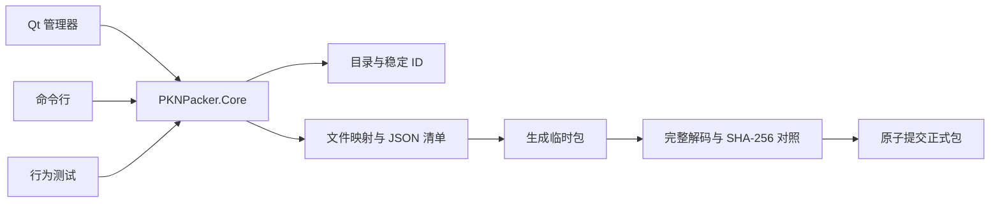

# 架构与数据流

## 工程边界

| 项目 | 职责 | 依赖 |
| --- | --- | --- |
| PKNPacker.Core | PKN v2 索引、SNOW 派生流、zlib、完整读取、工作区、事务写入、任务 | Windows SDK／BCrypt、zlib、nlohmann/json；不依赖 Qt／IDA／客户端 |
| PKNPacker | 中文 Qt Widgets 管理器、模型筛选、目录树、预览、编辑、批量任务 | Core、Qt Core／Gui／Widgets／Test，Qt/MSBuild moc/uic/rcc |
| PKNPacker.Cli | list／extract／pack／verify、选择器、JSON 报告、退出码 | Core |
| PKNPacker.Tests | 固定原始指令向量、异常输入、事务行为、编辑与样本回归 | Core；本地样本可选 |

源码中的核心测试使用合成输入和固定密码流向量；原始样本回归为可选输入。开发阶段的原始加载指令分析工具及机器相关证据不纳入源码发布。产品运行时只依赖核心实现和已声明的第三方组件。

## 读取和写入

磁盘字段使用明确宽度的小端读写；文件偏移、长度和中间运算用 uint64_t。读取器在分配前检查计数、路径长度、包内范围、重复路径和存储块重叠。正文以 64 KiB 流式读取，不把大资源整体载入内存。文本预览识别 BOM、UTF-8 和 UTF-16，首次最多读取 1 MiB；无法可靠识别时查看十六进制，每页 4 KiB。预览只读，不以截取内容声称完整校验，导出读取完整内容。

`ArchiveCatalog` 保存实际源包身份；`ArchiveEntry` 保留原始 UTF-16 URI、规范化查找路径、稳定 ID、flags、64 位大小／绝对偏移、16 字节密钥和索引校验。跨包冲突检查共用 `NormalizePath`，批量封包对工作区最终资源集合做检查；独立输出目录中既有但未参与本次批量任务的包需要使用者一并核对。

`ArchiveWorkspace` 支持完整解包和直接原包映射。未解包的 keep 条目可从匹配 SHA-256 的原包复制；外部修改文件、replace/add 内容会计算新摘要；delete 必须显式登记。原包记录不能从清单中隐式移除。源包条目身份和原始存储元数据在封包时再次复核。

源自已有包的工作区无论是否完整解包，封包时均会读取原包核验 SHA-256、条目身份和元数据；原包必须保持在清单记录的路径，包名与内容不变。从目录新建的工作区不依赖原包。部分解包清单不能重建完整包，需要继续解包补齐全部条目。

写入器按最终包名重新计算头／索引密钥和位置。未修改且可以复用的资源原始存储块保留；其它内容以已验证模式编码。所有条目的大小、相对 1024 块偏移、计数、校验和末尾对齐重新生成。临时文件经结构读取及逐项 SHA-256 对照后才通过 MoveFileEx 提交。输出占用、错误、取消会清理临时文件，既有目标保持完整。

## 清单与文件操作

`WorkspaceManifest.json` 使用 `PKNPacker.Workspace`／version 1，格式名 `BubbleFighter.PKN.v2`。根字段有 source、source_sha256、original_package_name、package_name、logical_directory、complete 和 entries。条目保存 id、path、file、flags、original_sha256、operation、extracted、original。

original 包含 raw_path_utf16le、flags、index_checksum、absolute_offset、size、stored_size、cipher_key。`Files/` 存完整解包；`Changes/<id>.bin` 存显式导入；manifest／report 等辅助文件不会进入归档。文件映射必须是工作区内的合法相对路径，拒绝 `..`、盘符、ADS、Windows 保留名、尾点／尾空格以及重解析点。

部分解包可继续补齐清单。重试成功后，全部原条目已完整导出才标为完整；已有待提交修改的工作区拒绝重新解包覆盖。撤销回到原路径映射，不会无提示地覆盖用户在 `Files` 中外部编辑的文件。

## 后台与结果

Core 的 `ArchiveJob` 统一取消和进度，`RunArchiveJobs` 默认两个任务线程，失败不停止其它独立包。GUI 主任务和预览线程分开，UI 只在主线程更新；多包可以并行，单包文件写入串行。列表缓存 UTF-16 显示路径，路径与数字排序直接读取缓存；搜索等待连续输入停止 200 ms 后一次重建代理映射，避免碎片化逐段删行拖慢大列表；工作区条目通过稳定 ID 表合并。改变搜索或选择会取消旧预览。结果表显示成功／跳过／失败／取消数量，双击解包／导出任务查看逐文件结果；失败和取消任务可重试。

CLI 正常报告走 stdout，进度走 stderr，支持 JSON 文件、并行数量和 Ctrl+C。原始加载指令、工具自身检查、真实客户端实测各自保留验证边界。
