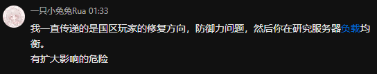

<div align="center">


# 🛠 BubbleFighter PKNPacker 🛠

**面向 BubbleFighter KR1304 的 Windows PKN 资源包管理器**

浏览资源 · 导出文件 · 编辑内容 · 重新封包


[](LICENSE)

<!---->
<!---->

[快速上手](#快速上手) · [构建指南](Docs/Build.md) · [命令行](#命令行) · [文档](#文档与贡献)

<table aria-label="community">
<tr>
<td align="center" width="360">
  <a href="https://qm.qq.com/q/fAcNMJVyuI">
    <br />
    <strong>加入 泡泡战士 K1ro 服社区</strong>
  </a>
  </td>
<td align="center" width="360">
  <a href="https://afdian.com/a/K1roSama1337">
    <br />
    <strong>通过 爱发电 支持我们！</strong>
  </a>
</td>
<td align="center" width="360">
  <a href="https://ko-fi.com/k1rosama">
    <br />
    <strong>请我们喝杯咖啡！</strong>
  </a>
</td>
</tr>
</table>

---

<table aria-label="CatsPub AI">
<tr>
<td align="center" width="840">
  <a href="https://catspub.com">
    <br />
    <strong>本项目由 Catspub 中转站获得支持</strong>
  </a><br />
  <sub>稳定 · 快速 · 用户至上</sub>
</td>
</tr>
</table>

</div>

## 感谢两位的慷慨付出

向本次促进开源推进的人表达感谢 ^ ^

没有你们的弱智发言，我们也不会加快工作进度。

**希望你们清楚，你们永远要为自己的发言负责，无论处于什么身份和地位。**

<details>
<summary>开源原因 | <b>⚠️多图预警/降智预警⚠️</b> </summary>

### 懒惰、贪婪

<blockquote>
  <p>"作为一名开发，我不应该考虑每个不同地区玩家的延迟最大程度缓解，现在的你，跟你之前的话，越发会发现你就是一个小丑，毕竟我可不需要披着别人的身份在网上装大王，最后再说一句脏话，你们两个傻逼就只会在自己那里舔韩国人当大王了。"</p>
  <p align="right">
    <sub>—— <strong>K1ro</strong> · 2026-10-12</sub>
  </p>
</blockquote>



### 傲慢、暴怒

<blockquote>
  <p>"你跟那个喜欢伪造他人的小丑一样，总把自己摆在一个很高的位置上，结果你也不知道自己什么能力，没有一个人看得起你，只会没有任何事实依据的情况下想办法去抹黑他人。你的行为跟你说的话倒是符合了你从其他某国学来的特征，我不接受你的道歉，同时还你一句闹麻了。"</p>
  <p align="right">
    <sub>—— <strong>K1ro</strong> · 2026-10-12</sub>
  </p>
</blockquote>


</details>

## 项目介绍

提供中文图形界面和命令行工具，支持多包浏览、搜索预览、导出解包、资源编辑、重封与新建。封包时自动完整解码并核对内容 SHA-256，通过后才提交正式文件。

| 功能 | 说明 |
| --- | --- |
| 打开与浏览 | 打开一个或多个 PKN，或扫描包含 PKN 的目录；目录树和文件列表保留来源包信息 |
| 搜索与筛选 | 内部路径搜索、扩展名筛选、排序和多选 |
| 基础预览 | BOM、UTF-8、UTF-16 文本识别；无法可靠识别时查看十六进制，支持分页 |
| 导出与解包 | “拆包”按钮导出单个文件、选中文件／目录导出、选择解包、多个包完整解包 |
| 资源编辑 | 导入替换文件、显式新增／删除、撤销待提交操作、查看变更和路径冲突 |
| 重封与新建 | 从带清单的工作区重建多个包，或从输入目录和资源命名空间新建 PKN |
| 后台任务 | 默认两个独立包并行，提供进度、取消、逐项结果和失败重试 |
| 自动化接口 | `list`、`extract`、`pack`、`verify`，JSON 输出／报告和明确退出状态 |

## 快速上手

完成部署后运行 `Artifacts/Distribution/Release/PKNPacker.exe`：

1. **打开**：选择 PKN 文件或扫描 `Packs` 目录，搜索、预览并导出资源。
2. **修改**：在外部编辑器中修改文件，通过“替换”导入，或完整解包后编辑工作区。
3. **封包**：点击“检查变更”，再用“批量封包”生成并验证新包。

首次构建需要 Windows x64、Visual Studio 2022 C++ 开发组件和 Python。在 PowerShell 中执行：

```powershell
git clone https://github.com/K1roSama/BubbleFighter_PKNPacker.git
cd .\BubbleFighter_PKNPacker
python -m pip install requests py7zr
python .\Tools\SetupDependencies.py
.\Tools\Deploy.ps1
```

完整环境要求及已有 Qt 配置见[构建指南](Docs/Build.md)；编辑、解包与工作区规则见[使用指南](Docs/Usage.md)。

脚本从 Qt 官方源获取指定版本，将 Qt、Qt/MSBuild 和下载记录保存到忽略的 `Artifacts/Dependencies`。Qt 组件按官方校验文件核对，并记录下载内容的 SHA-256。

也可使用已有安装，复制并编辑本地配置：

```powershell
Copy-Item .\Build\Local.props.example .\Build\Local.props
```

```xml
<?xml version="1.0" encoding="utf-8"?>
<Project xmlns="http://schemas.microsoft.com/developer/msbuild/2003">
  <PropertyGroup>
    <QtRoot>C:\Qt\6.11.1\msvc2022_64</QtRoot>
    <QtMsBuild>C:\QtMsBuild</QtMsBuild>
  </PropertyGroup>
</Project>
```

`QtRoot` 应包含 `bin/qmake.exe`；`QtMsBuild` 应直接包含 `qt.props` 和 `qt.targets`。`Build/Local.props` 不提交到 Git。

### 3. 编译和运行

```powershell
.\Tools\Build.ps1 -Configuration Debug
.\Tools\Build.ps1 -Configuration Release
.\Tools\Deploy.ps1 -SkipBuild
.\Artifacts\Distribution\Release\PKNPacker.exe
```

也可直接在 Visual Studio 2022 打开 `PKNPacker.sln`，选择 `x64` 后构建。编译输出位于 `Artifacts/Bin/x64/<配置>`，脚本构建日志位于 `Artifacts/Logs`。GUI 运行需要 Qt DLL 和平台插件；上述部署步骤会收集它们，已有 Qt 安装时先按下文设置 `PKNPACKER_QT_ROOT`。CLI 与核心测试可直接从编译输出目录运行。

只构建核心库时：

```powershell
.\Tools\Build.ps1 -Configuration Release -CoreOnly
```

只使用 CLI 或核心测试时，也可在 VS 中单独构建相应项目及其 Core 依赖。

## 图形界面使用

1. 点击“打开 PKN”选择一个或多个资源包，或点击“扫描目录”选择 `Packs`。在左侧选择包／目录，在右侧搜索、筛选和选择文件。
2. 选择文件查看文本／十六进制。选中一个文件后点击文件操作栏最前面的“拆包”，选择保存位置即可导出完整内容；“导出选中文件”按来源包保留目录结构。
3. “选择解包”将当前选中的文件／目录导出为带清单的部分工作区；“完整解包”导出完整工作区。
4. 通过外部编辑器修改内容，使用“替换”导入；需要调整文件集合时使用“新增”“删除”“撤销操作”。
5. 点击“检查变更”，核对数量、路径和冲突；使用“批量封包”生成到独立输出目录。
6. 从目录新建包时，指定输入目录、内部命名空间、输出包名和工作区，检查后生成。

解包遇到已有目标文件默认跳过，可在创建任务时选择覆盖。封包遇到已有输出默认失败，需显式选择替换。当前输入包受到覆盖保护；取消或失败会清理未提交的临时包，已完成的独立任务结果保留。

## 工作区与包名规则

完整解包的典型结构：

```text
Extracted/
└── Shader_00000/
    ├── WorkspaceManifest.json
    ├── Files/
    │   └── Shader/Shader.vsh
    └── Changes/
```

`WorkspaceManifest.json` 使用版本 1，目标格式为 `BubbleFighter.PKN.v2`。清单记录来源包实际名称、逻辑目录、源包 SHA-256、条目 ID、原始路径和存储元数据、内容 SHA-256，以及新增／替换／删除操作。清单、报告和辅助文件不进入 PKN。

完整解包后可直接编辑 `Files` 内的内容，封包时会比较 SHA-256。文件缺失会报错，删除需要显式登记。直接从原包建立的映射工作区会继续读取未修改资源，原包必须保持可访问。部分工作区可在同一输出根继续解包补齐；全部条目完整导出后才成为完整解包工作区。已有待提交操作时会拒绝再次解包覆盖。

**实际包名参与偏移和密钥生成。** 使用 `Name_00000.pkn` 形式的 ASCII 包名；需要改名时通过工具重新生成，直接重命名生成文件会改变客户端读取所需的身份。

内部路径使用 UTF-16，查找规则统一 ASCII 大小写和斜杠。跨包重复的规范化资源路径会产生冲突；替代包投入同一套资源目录时，应避免同时保留含同路径资源的原包。新包请使用独立命名空间，例如 `Images/Custom`。新增资源可被读取与游戏实际引用该资源是两个条件，实际使用还需要相应资源引用。

## 命令行

在构建后的仓库根目录运行，将输入路径替换为自己的资源包目录：

```powershell
$cli = '.\Artifacts\Bin\x64\Release\PKNPacker.Cli.exe'
& $cli list 'D:\Game\Packs' --ext .xml
```

`list`、`extract`、`pack`、`verify` 的完整示例与选项见[命令行参考](Docs/CommandLine.md)。

> 当前支持 KR1304 的 PKN v2。重封工作区需要保留原包，包名变更需重新封包；真实游戏中的加载和界面效果尚未验收，详见[使用指南](Docs/Usage.md)与[验证说明](Docs/Validation.md)。

## 文档与贡献

| 文档 | 内容 |
| --- | --- |
| [构建指南](Docs/Build.md) | 环境、Qt 配置与运行 |
| [使用指南](Docs/Usage.md) | 图形界面、工作区与使用限制 |
| [命令行参考](Docs/CommandLine.md) | 命令、选项与 JSON 报告 |
| [架构说明](Docs/Architecture.md) | 模块、读写流程与清单结构 |
| [格式说明](Docs/Format.md) | PKN v2 字段与存储规则 |
| [验证说明](Docs/Validation.md) | 测试复现与兼容边界 |
| [开发指南](CONTRIBUTING.md) | 开发、测试、分发与贡献 |

欢迎提交问题和改进；反馈时请附上客户端版本、复现步骤及错误信息。

## 许可证

项目自有源码采用 [Apache License 2.0](LICENSE)，第三方许可见[第三方依赖说明](ThirdPartyNotices.md)。
